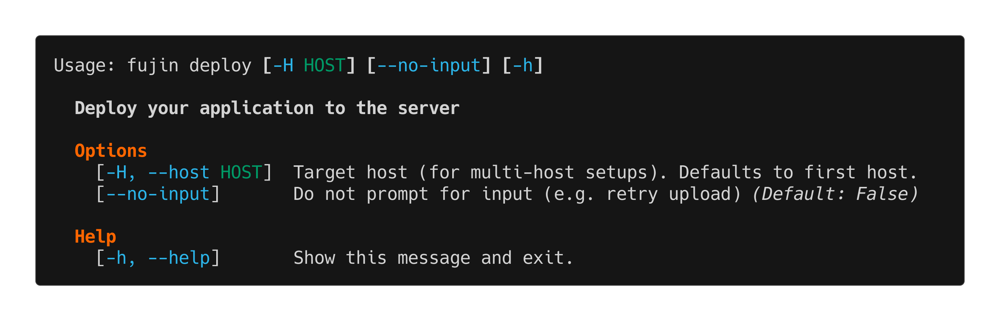

deploy
======

The ``fujin deploy`` command deploys your application to the server.

Overview
--------

This is the core deployment command. It builds your application locally, bundles all necessary files, uploads them to the server, and installs/configures everything.

Use ``fujin deploy`` for:

- Deploying code changes
- Updating configuration
- Updating environment variables
- Refreshing systemd units or Caddy configuration

How it works
------------

Here's a high-level overview of what happens when you run the ``deploy`` command:

1. **Resolve Secrets**: If you have a ``secrets`` configuration, Fujin retrieves secrets defined in your environment file from the configured adapter (Bitwarden, 1Password, Doppler, etc.).

2. **Build (with cache)**: Your application is built locally using the
   ``build_command`` from the configuration. The result is stored under
   ``.fujin/cache/bundles/<bundle_key>/``; a rebuild is skipped when the
   bundle key (build command, build env, requirements, unit/Caddyfile/asset
   sources, config fingerprint) is unchanged and the cached file hashes
   still verify. Opt out with ``--no-cache``.

3. **Assemble the Release Tree**: Fujin assembles the client-known tree
   (interpolated systemd unit files and dropins, Caddyfile, assets,
   requirements.txt) plus the rendered ``.env``, and computes a client-side
   manifest. Server-built entries (``venv/`` or ``bin/``) are hashed on the
   server after installation and merged in. The release digest
   (``releases/<digest>/``) is the sha256 of the canonical manifest.

4. **No-op Detection**: If the client digest matches the live release's
   digest, nothing changed: transfer/install is skipped entirely (no
   restart); replica counts are still converged. Use ``--force`` to perform
   a full deploy anyway (e.g. to re-run hooks).

5. **Stage and Upload**: The tree is rsynced into
   ``releases/.staging-<pid>/``; unchanged files (mostly dependencies) were
   already server-side deduplicated by hardlinking every byte-identical
   file from the live release, so only changed content is re-uploaded
   (rsync requires key-based SSH auth).

6. **Verify and Commit**: The staging tree is verified on the server against
   ``manifest.json`` (one file entry per path: sha256, mode, kind). Only then
   is it renamed to its immutable release dir ``releases/<digest>/``.
   A verification failure aborts the deploy, deletes the staging tree, and
   leaves the previous release live.

7. **Install Units and Caddyfile**: Systemd unit files, dropins (including
   ``common.d``) and the Caddyfile are installed into the usual system
   locations (``/etc/systemd/system``, ``/etc/caddy/conf.d``).

8. **Activate**: ``current`` is atomically swapped to the new release
   (``current.next`` + ``mv -T``), then services restart according to a
   diff-based restart set (#see "Restart behaviour" below), buildings
   replica counts are converged, and readiness is polled. If services fail
   to start, Fujin automatically offers to roll back to the previously live
   release (auto with ``--no-input``); if you decline, the swap stays in
   place and the deploy exits with an error.

9. **Record and Prune**: The release store (``store/state.json``) is updated,
   old releases are garbage-collected according to ``versions_to_keep``,
   and deployment metadata (version, timestamp, git commit) is appended to
   the audit log.

10. **Completion**: A success message is displayed with deployment details,
   including the application URL if a Caddyfile is configured.

Restart behaviour
~~~~~~~~~~~~~~~~~

The restart set is computed by diffing the previous live release manifest
against the new one:

- **Unit file changed**: restart that unit only (all of its instances).
- **Environment changed**: all app service units are fed from ``.env``, so
  every app service unit restarts.
- **Code changed** (dist sha256 or code entries): restart all app units.
- **Caddyfile changed**: reload Caddy only.
- **Assets changed**: no restart.

Pass ``--full-restart`` to restart every unit instead.

Hooks run in three phases: ``pre_install`` (old release still live),
``post_install`` (new release committed but not yet live; the hook's
``{app_dir}`` resolves to the new release directory), and ``post_start``.

Deployment Layout and Permissions
----------------------------------

All applications are deployed to ``/opt/fujin/{app_name}`` with a secure permission model that separates deployment and runtime privileges.

Directory Structure
~~~~~~~~~~~~~~~~~~~

Every deploy creates an immutable, content-addressed release directory
(``releases/<digest>/``, digest = sha256 of the release manifest), and the
``current`` symlink is the only activation point:

.. code-block:: shell

    /opt/fujin/{app_name}/
    ├── current -> releases/<digest>      # atomic activation symlink
    ├── releases/
    │   ├── <digest>/                     # immutable release tree
    │   │   ├── manifest.json             # file inventory (sha256, mode, kind)
    │   │   ├── .env                      # rendered env file (640)
    │   │   ├── venv/ | bin/              # installed app code
    │   │   ├── systemd/                  # unit files as deployed
    │   │   └── Caddyfile                 # when configured
    │   └── .staging-<pid>/               # transfer target, removed after commit
    ├── store/
    │   ├── lock                          # deploy lock (flock)
    │   └── state.json                    # current/previous digests, deploy log
    ├── shared/                           # persistent app data
    └── db.sqlite3, uploads/...           # app runtime data

``releases/``, ``store/`` and the app dir are setgid ``2755`` owned by
``{deploy_user}:{app_user}``; ``shared/`` is ``2775``. The rendered ``.env``
is mode ``0640`` (group-readable by the app user).

Unit files still live in ``/etc/systemd/system/`` and the Caddyfile in
``/etc/caddy/conf.d/{app_name}.caddy``; unit templates should reference the
release tree through the ``current`` symlink, e.g.
``ExecStart={{ app_dir }}/current/venv/bin/myapp`` or
``EnvironmentFile=-{{ app_dir }}/current/.env``, so the active release
follows the symlink at start time.

Because releases are immutable, application runtime data must live in
``shared/`` (or the app directory root) rather than inside a release
directory.

Shared Python Directory
~~~~~~~~~~~~~~~~~~~~~~~~

Python versions are installed in a shared directory accessible to all applications:

.. code-block:: shell

    /opt/fujin/.python/
    └── cpython-3.13.11-linux-x86_64-gnu/
        └── bin/python3.13

This shared location (configured via ``UV_PYTHON_INSTALL_DIR``) allows
multiple applications to share Python installations, keeps ``ProtectHome=true``
safe, and survives deploy-user changes. The venv inside every release points
at the shared interpreter.

Permission Model
~~~~~~~~~~~~~~~~

Fujin uses a multi-user security model with three components:

1. **fujin group** (``root:fujin``): Members can deploy applications

   - Created during ``fujin server bootstrap``
   - Deploy users are added to this group
   - Grants write access to ``/opt/fujin/``

2. **Deploy user** (e.g., ``tobi``): Owns application files

   - Member of ``fujin`` group
   - Can deploy and manage applications
   - Owns the ``releases/`` and ``store/`` infrastructure (setgid 2755)

3. **App user** (e.g., ``bookstore``): Runs services

   - Non-privileged user created per-application
   - Cannot modify application code or ``current/venv``
   - Can write to database files and logs within app directory
   - Used automatically for ``fujin server exec --appenv`` and ``fujin app`` commands

Immutable release directories and the setgid deployment infrastructure isolate deployment from application runtime data. This means:

- Deployment operations (like ``chown``) only touch ``releases/``, ``store/`` and ``shared/``, not app data
- App runtime files (databases, caches, uploads) remain owned by the app user
- Every deploy atomically swaps ``current``; a failed activation leaves the previous release live

.. note::

   **Running Commands as App User**

   When you use ``fujin server exec --appenv`` or ``fujin app exec``, commands automatically run as the app user (not the deploy user). This ensures commands can write to app-owned files like databases, logs, and uploads.

   For example, Django's ``createsuperuser`` command needs to write to ``db.sqlite3`` (owned by ``bookstore:bookstore``). Running it as the deploy user would fail with permission errors. Fujin handles this automatically:

   .. code-block:: bash

      # These commands run as the app user
      fujin app shell                    # Opens shell as 'bookstore'
      fujin server exec --appenv python  # Runs Python as 'bookstore'
      fujin app exec migrate             # Runs Django migration as 'bookstore'

      # Plain server commands still run as deploy user
      fujin server exec ls -la           # Runs as 'tobi' (deploy user)

Example permissions:

.. code-block:: shell

    /opt/fujin/                      root:fujin       drwxrwxr-x (775)
      ├── .python/                   root:fujin       drwxrwxr-x (775)
      └── bookstore/                 tobi:bookstore   drwxrwxr-x (2755, setgid)
          ├── current                tobi:bookstore   -> releases/<digest>
          ├── releases/              tobi:bookstore   drwxrwsr-x (2755)
          │   └── <digest>/
          │       ├── .env           tobi:bookstore   -rw-r----- (640)
          │       └── venv/          tobi:bookstore   drwxr-xr-x (755)
          ├── store/                 tobi:bookstore   drwxrwsr-x (2755)
          ├── shared/                tobi:bookstore   drwxrwxr-x (2775)
          └── db.sqlite3             bookstore:...    -rw-r--r-- (664)

Security Benefits
~~~~~~~~~~~~~~~~~

This model provides defense-in-depth:

- **Process isolation**: Services run as non-root app user
- **Code protection**: App user cannot modify source code or ``current/venv``
- **Database access**: App user can read/write database files
- **Home directory isolation**: Systemd ``ProtectHome=true`` prevents access to ``/home``
- **System protection**: Systemd ``ProtectSystem=strict`` makes most of filesystem read-only
- **Multi-user support**: Any member of ``fujin`` group can deploy

If an application is compromised, the attacker:

- ✗ Cannot modify application code
- ✗ Cannot access other users' home directories
- ✗ Cannot access other applications' directories (no read/write permissions)
- ✓ Can only read/write within the app directory with group permissions

Migrating Existing Deployments
~~~~~~~~~~~~~~~~~~~~~~~~~~~~~~

Applications deployed with an older fujin (``.install/.venv/`` and
``.install/.versions/*.pyz`` layout) migrate automatically and
**non-destructively**:

1. On the first deploy with the new fujin, you get a one-time notice that
   the legacy layout is detected.
2. A fresh release tree (``current``, ``releases/``, ``store/``, ``shared/``)
   is created and deployed to; the old ``.install/`` and ``.versions/``
   directories are kept in place until you clean them up.
3. ``fujin rollback`` only works after that first release-tree deploy (the
   old zipapp bundles are not used anymore).
4. ``fujin down`` removes the release tree, the systemd units, the app user,
   and any leftover legacy directories.
