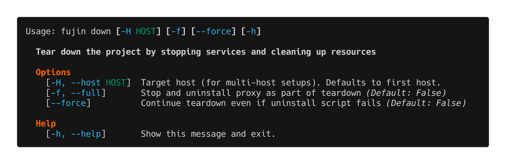

down
====

The ``fujin down`` command tears down your application by stopping services and removing resources.

Overview
--------

Use ``fujin down`` to remove your application from the server. The command runs the bundle's uninstall script, which stops and disables systemd services, removes systemd unit files, cleans up Caddy configuration, deletes the application user, and removes the application directory.

.. warning::

   This command removes your application from the server. The application directory and all files within it will be deleted. Use with caution.

Options
-------

``-f, --full``
   Also uninstall Caddy web server. Use this if you're completely removing fujin from the server.

``--force``
   Continue teardown even if the uninstall script fails. When set, forces removal of the app directory regardless of errors.

How it works
------------

Here's what happens when you run ``fujin down``:

1. **Prompt for confirmation**: Shows a warning message about the irreversible action and asks for confirmation.

2. **Stop services**: Stops and disables all configured systemd services (app services, sockets, timers).

3. **Legacy uninstall**: If the app still has an old-style ``.versions/*.pyz`` bundle, its uninstall script is executed first.

4. **Remove app directory**: Deletes the entire application directory
   (``/opt/fujin/your-app``), including the release tree
   (``releases/``, ``store/``, ``shared/``), any leftover legacy
   ``.install/``/``.versions/`` directories, and the application user is
   deleted.

5. **Uninstall Caddy** (if ``--full``): Removes the Caddy web server from the system.

6. **Log operation**: Records the teardown to the audit log as either ``down`` or ``full-down``.

If the remove step errors and ``--force`` is not set, the command exits with an error. With ``--force``, it continues and force-removes the app directory using ``rm -rf``.

See Also
--------

- :doc:`deploy` - Deploy application
- :doc:`up` - Bootstrap server
