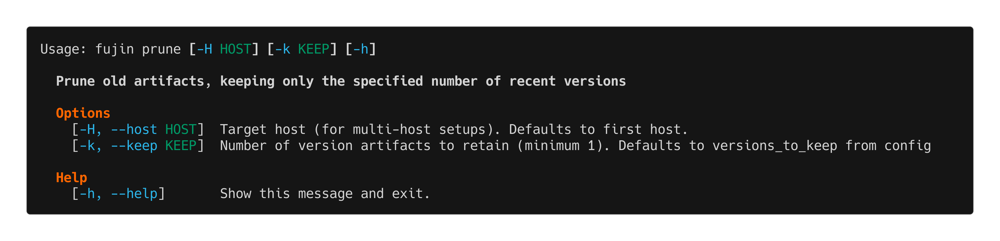

prune
=====

The ``fujin prune`` command removes old release directories, keeping only a specified number of recent ones.

Overview
--------

Every deploy stores its release tree in
``/opt/fujin/{app_name}/releases/<digest>/``. Over time, these release
directories accumulate. The prune command helps manage disk space by
removing old releases while keeping recent ones for rollback capability.

Fujin automatically garbage-collects old releases after each deployment
based on the ``versions_to_keep`` setting in your ``fujin.toml``. Use
``fujin prune`` to manually clean up releases when you need to free up disk
space or keep fewer releases than configured.

Options
-------

``-k, --keep N``
   Number of recent releases to keep (minimum 2, since current and previous
   are always kept). Default: the ``versions_to_keep`` configuration value.

How it works
------------

1. **Read the release store**: Loads ``store/state.json`` and lists the
   releases under ``releases/``.

2. **Compute the keep set**: The set that is always kept is the current
   release plus ``previous[0]``, plus the newest releases by deploy order,
   up to ``versions_to_keep`` in total.

3. **Prompt for confirmation**: Shows which release digests will be deleted
   and asks for confirmation before proceeding.

4. **Delete old releases**: Removes the selected release directories.

The command is safe - it only removes old release directories and doesn't
affect your currently running application, the ``current`` symlink, or any
services.

.. note::

   Releases removed here are permanently gone: a later ``fujin rollback
   --to <digest>`` for a pruned release is an error. Redeploy the old
   commit instead.

See Also
--------

- :doc:`deploy` - Automatic pruning after deployment
- :doc:`rollback` - Uses kept releases for rollback
