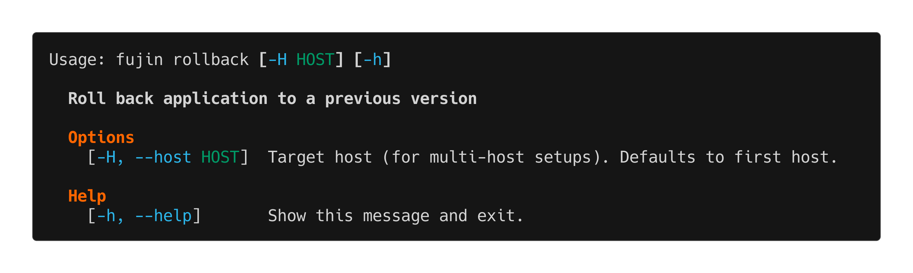

rollback
========

The ``fujin rollback`` command rolls back your application to a previous
release.

Overview
--------

When a deployment goes wrong, ``fujin rollback`` quickly reverts to a previous
release. Fujin keeps immutable releases on the server under
``/opt/fujin/{app_name}/releases/<digest>/`` and activates them through the
``current`` symlink; rollback is a symlink swap plus restart, not a
re-install.

Rollback targets are the releases the release store keeps (the keep set is
``current`` + ``previous[0]`` plus the newest releases by deploy order, up
to ``versions_to_keep`` in total). By default a target is selected
interactively; use ``--previous`` (or ``-p``) to roll back to the
immediately-previous release without prompting, and ``--to <digest>`` to
roll back to a specific release.

How it works
------------

1. **Resolve target**: Read ``store/state.json`` and ``releases/``; pick the
   target release. Releases removed by pruning are never offered and
   ``--to <digest>`` for a garbage-collected release is a hard error
   (redeploy the old commit instead).

2. **Verify target tree**: The target release directory is verified against
   its manifest before anything is swapped.

3. **Swap symlink**: ``current`` is atomically switched to the target
   release (``current.next`` + ``mv -T``).

4. **Reinstall units**: Unit files from the target release are installed
   into ``/etc/systemd/system`` (no uninstall of the previous version is
   needed - unit files are simply overwritten).

5. **Converge and restart**: Replica instances are converged to the target
   release's counts, and services restart according to the manifest diff
   between the current and target releases.

6. **Log and clean up**: The store is updated (single-level: the target
   becomes ``current``, ``previous`` reflects the release you came from) and
   old releases are garbage-collected. The rollback operation is recorded in
   the audit log with from/to version information.

Rollback is single-level: a failed rollback never recurses into another
rollback; inspect the server manually instead.

.. warning::

   Rollback does NOT automatically revert database migrations. If your
   deployment included schema changes, you'll need to handle database
   rollback separately - either restore from backup or manually reverse
   migrations using your framework's migration tools.

If the app was last deployed with an old fujin (no ``store/`` yet), deploy
once with this version first; the migration is non-destructive.

See Also
--------

- :doc:`deploy` - Deploy application
- :doc:`prune` - Manually manage old releases
- :doc:`audit` - View deployment history
