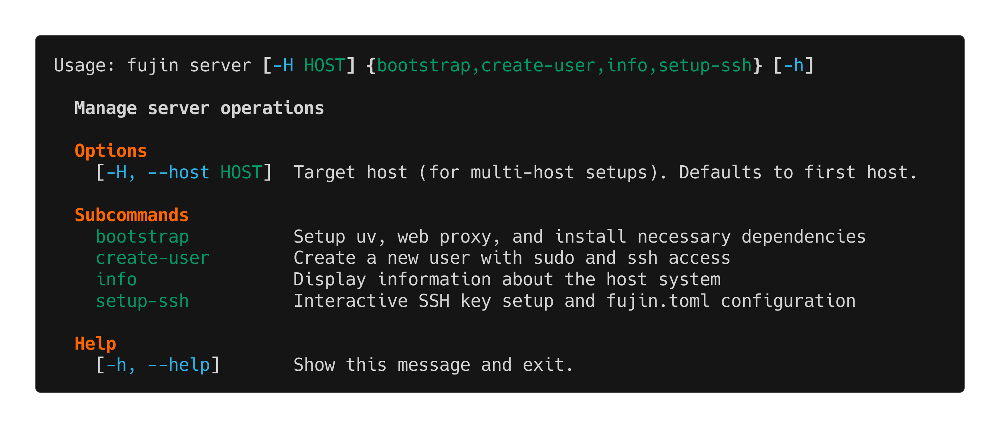
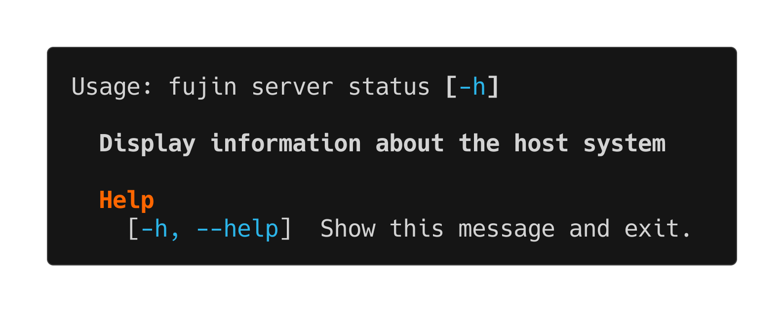
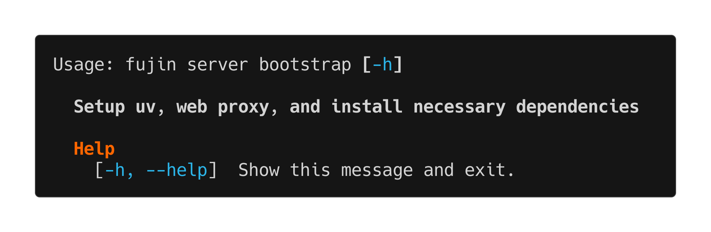
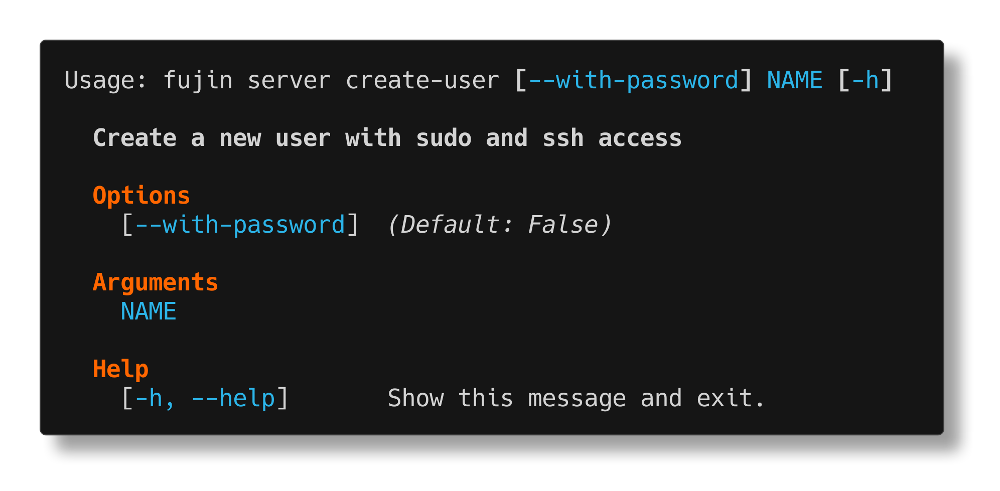
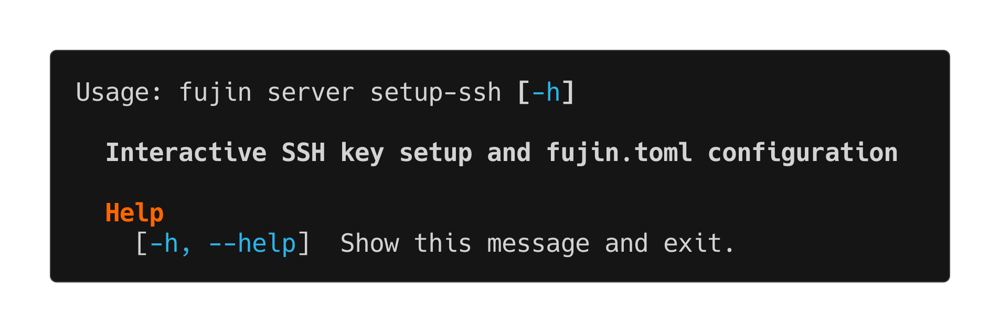

server
======

The ``fujin server`` command provides server management operations.

Overview
--------

Use ``fujin server`` to manage server-level operations:

- View server information
- Bootstrap server with required dependencies
- Upgrade server components (Caddy, uv, Python, system packages)
- Create deployment users with a scoped sudo rule
- Harden an existing server (replace ``NOPASSWD:ALL`` with the scoped rule)
- Set up SSH keys
- Execute commands on the server with optional app environment

Subcommands
-----------

status
~~~~~~

Display system information about the host.

Shows OS version, CPU, memory, and other system details using fastfetch when available.

**Example:**

.. code-block:: bash

   $ fujin server status

bootstrap
~~~~~~~~~

Install system dependencies required for fujin deployments.

This command:

- Creates ``/opt/fujin`` directory structure with proper permissions
- Creates ``/opt/fujin/.python`` shared Python installation directory
- Installs uv (Python package manager)
- Installs Caddy web server (if webserver enabled)
- Sets up necessary system packages
- Configures Caddy to auto-load configurations from ``/etc/caddy/conf.d/``

The bootstrap process creates a shared Python directory at ``/opt/fujin/.python`` where UV installs Python interpreters. This allows:

- Multiple applications to share Python installations
- Stronger systemd security with ``ProtectHome=true`` (home directories completely inaccessible)
- Better isolation between deployment users and runtime users

**Example:**

.. code-block:: bash

   $ fujin server bootstrap

.. note::

   This is automatically run as part of ``fujin up``, so you typically don't need to run it manually.

upgrade
~~~~~~~

Upgrade server components to their latest versions.

This command upgrades:

- **System packages** - Updates all installed packages via apt (non-critical, won't stop other upgrades if it fails)
- **Caddy web server** - Upgrades to the latest version using ``caddy upgrade``
- **uv package manager** - Updates uv to the latest version using ``uv self update``
- **Python installations** - Upgrades all Python versions managed by uv using ``uv python upgrade``

The upgrade command shows version changes (e.g., "Caddy upgraded from v2.7.0 to v2.8.0") and gracefully skips components that aren't installed.

**Example:**

.. code-block:: bash

   $ fujin server upgrade

**Output example:**

.. code-block:: console

   Upgrading server components...
   Upgrading system packages...
   ✓ System packages upgraded successfully!
   Upgrading Caddy web server...
   ✓ Caddy upgraded from v2.7.0 to v2.8.0!
   Upgrading uv package manager...
   ✓ uv is already at the latest version (uv 0.5.0)
   Upgrading Python installations...
   ✓ Python installations upgraded successfully!
   ✓ All server components upgraded successfully!

.. note::

   System package upgrades (apt) are non-critical - if they fail, the command will continue upgrading other components. This ensures Caddy, uv, and Python upgrades can still proceed even if system packages have issues.

create-user
~~~~~~~~~~~

Create a new user with a scoped sudo rule and SSH key setup.

This is an **administrator action** (creating users needs full sudo); it is
not part of the scoped deploy rule.

Creates a deployment user with:

- A scoped passwordless sudo rule in ``/etc/sudoers.d/fujin-<name>``
  (see :ref:`deploy-user-sudo` for the exact command list)
- SSH keys copied from the current user
- A home directory with proper permissions

The rule is installed by one root shell script: checked with
``visudo -c -f`` before installation, ``install -m 0440 -o root -g root``
into the drop-in path, and the complete configuration validated with
``visudo -c`` afterwards. The scratch file is an unpredictable root-owned
``mktemp`` file inside ``/etc/sudoers.d`` (never ``/tmp``), and any failure
restores the previous drop-in. ``fujin`` never appends ``NOPASSWD:ALL`` to
``/etc/sudoers``.

Before creating anything, ``create-user`` verifies that ``/etc/sudoers``
loads ``/etc/sudoers.d`` (inside the root script too). If the include is
missing it aborts with instructions; a rule sudo would ignore is never
installed and success is never reported.

.. code-block:: bash

   $ fujin server create-user deploy

This creates a user named "deploy" that you can use for deployments.

.. note::

   The rule includes a ``sudo -u <app_user>`` (Runas) entry used by
   ``server exec --appenv``. The app user is unprivileged, so that entry
   does not grant root.

   User names containing ``.`` are rejected: sudo ignores includedir files
   whose name contains a dot, so such a drop-in would silently never load.

harden
~~~~~~

Replace ``NOPASSWD:ALL`` with the scoped sudo rule on an existing server.

This is an **opt-in, administrator-only migration**: it runs the whole
change as one ``sudo bash`` transaction, so the connecting user needs full
sudo. Servers created by older fujin versions still carry
``<user> ALL=(ALL) NOPASSWD:ALL``; nothing changes until you run this
command.

.. code-block:: bash

   # Preview the rule and the exact /etc/sudoers edit
   $ fujin server harden --dry-run

   # Apply it (needs full sudo)
   $ fujin server harden

The root script:

1. Refuses to run unless ``/etc/sudoers`` includes ``/etc/sudoers.d``
   (installing the drop-in without the include would be ignored).
2. Installs ``/etc/sudoers.d/fujin-<user>`` from an unpredictable
   root-owned ``mktemp`` file inside ``/etc/sudoers.d``, after
   ``visudo -c -f`` and with mode ``0440 root:root``.
3. If the user's exact whole-line rule exists in the current
   ``/etc/sudoers`` (``<user> ALL=(ALL) NOPASSWD:ALL`` or the ``(ALL:ALL)``
   spelling), backs it up to
   ``/etc/sudoers.fujin-backup-<UTC timestamp>`` and replaces the file with
   an exact-line-filtered copy that passed ``visudo -c -f``. The filter runs
   inside the script against the live file; other users, comments and
   compound/list rules are preserved. No backup is written when no rewrite
   is needed.
4. Runs a final ``visudo -c`` and verifies with ``sudo -l -U <user>`` that
   the ``FUJIN_DEPLOY`` alias is visible and no ``NOPASSWD: ALL`` rule
   remains.
5. Prints ``FUJIN_HARDEN_OK`` (or ``FUJIN_HARDEN_FAILED reason=...``). A
   ``trap`` restores both ``/etc/sudoers`` and the previous drop-in on any
   failure and re-validates, so there is no path that ends without
   passwordless sudo while claiming success.

Run ``fujin deploy`` afterwards (as the deploy user) to confirm a normal
deployment still works.

**Dry run output** shows the rendered drop-in and the line that would be
removed; it makes no changes to the server.

setup-ssh
~~~~~~~~~

Interactive wizard to set up SSH keys and update fujin.toml.

This interactive command:

- Generates SSH keys if needed
- Copies keys to the server
- Updates fujin.toml with key path
- Configures SSH connection settings

**Example:**

.. code-block:: bash

   $ fujin server setup-ssh

Common Workflows
----------------

**Initial server setup**

Bootstrap and user creation are administrator actions (they need full sudo);
the scoped rule only covers deployment.

.. code-block:: bash

   # 1. Set up SSH keys (if not already configured)
   fujin server setup-ssh

   # 2. Bootstrap the server as an administrator (full sudo)
   fujin server bootstrap

   # 3. Create a deployment user (administrator action)
   fujin server create-user deploy

   # 4. Update fujin.toml to use the new user
   # Edit fujin.toml: user = "deploy"

   # 5. Deploy as the new user with only the scoped sudo rule
   fujin deploy

**Or use the all-in-one command (requires full sudo for bootstrap):**

.. code-block:: bash

   fujin up  # Does bootstrap + deploy in one step

**Migrate an existing server off NOPASSWD:ALL**

.. code-block:: bash

   # 1. Inspect the scoped rule and the /etc/sudoers edit
   fujin server harden --dry-run

   # 2. Apply it as an administrator (one root transaction, opt-in,
   #    /etc/sudoers is backed up and restored on failure)
   fujin server harden

   # 3. Confirm deployments still work
   fujin deploy

**Keep server up to date**

.. code-block:: bash

   # Upgrade all server components
   fujin server upgrade

   # Target specific host
   fujin server upgrade -H production

**Check server status**

.. code-block:: bash

   fujin server status

exec
~~~~

Execute commands on the server, with optional app environment.

**Usage:**

.. code-block:: bash

   fujin server exec [--appenv] COMMAND [ARGS...]

**Options:**

``--appenv``
   Change to app directory and load environment from the live release's ``.env``. Runs as the app user.

``-H, --host HOST``
   Target a specific host in multi-host setups.

**Plain Server Command (default):**

Run any command on the server as the deploy user:

.. code-block:: bash

   # Check disk space
   fujin server exec df -h

   # View processes
   fujin server exec ps aux

   # Any server command
   fujin server exec ls -la /var/log

**With App Environment (--appenv):**

Run commands in your app directory with environment variables loaded as the app user:

.. code-block:: bash

   # Run Python script with app environment
   fujin server exec --appenv python script.py

   # Access database with credentials from .env
   fujin server exec --appenv psql -U \$DB_USER -d \$DB_NAME

   # Start interactive bash in app directory
   fujin server exec --appenv bash

This is equivalent to:

.. code-block:: bash

   cd /path/to/app && source current/.env && your-command

.. important::

   **User Context:** Commands run with different permissions depending on the flag:
   
   - **Without --appenv**: Run as the deploy user
   - **With --appenv**: Run as the app user (can write to app-owned files)

**Common patterns with aliases:**

Create shortcuts in ``fujin.toml``:

.. code-block:: toml

   [aliases]
   bash = "server exec --appenv bash"
   logs = "server exec tail -f /var/log/syslog"

**Examples:**

.. code-block:: bash

   # Database operations with environment
   fujin server exec --appenv 'psql -U $DB_USER -d $DB_NAME'

   # Export database
   fujin server exec --appenv 'pg_dump $DB_NAME' > backup.sql

   # Check disk space on production
   fujin server exec df -h -H production

   # Run maintenance script
   fujin server exec --appenv python healthcheck.py

See Also
--------

- :doc:`app` - Application management and ``app exec`` command
- :doc:`up` - One-command server setup and deployment
- :doc:`deploy` - Deployment workflow and permission model
- :doc:`../howtos/index` - Setup guides
- :doc:`../configuration` - Host configuration reference
